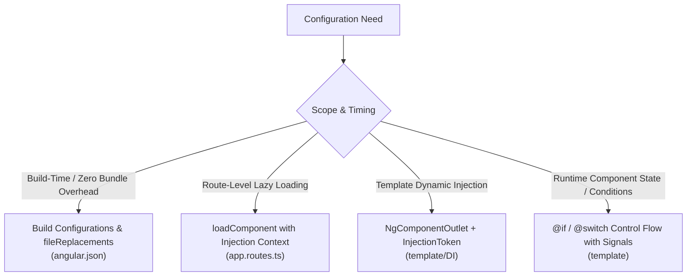

# Research Report: Publishing CareBase Frontend to Static Hosting (GitHub Pages)

**Status:** Complete  
**Date:** 2026-10-16  
**Primary Topics:** Angular Static Hosting, In-Memory Domain Adapters, GitHub Pages Deployment, Angular Build Configurations, Dynamic Component Configuration  

---

## 1. Executive Summary & Feasibility

### 1.1 Direct Feasibility Assessment
**Publishing the CareBase frontend as standalone static files to GitHub Pages is fully feasible, architecturally sound, and already 90% supported by the existing codebase.**

CareBase's frontend is designed around clean decoupling and domain interfaces. Specifically:
1. **Domain Data Access Abstraction:** All patient, doctor, clerk, appointment, treatment, and reporting operations are mediated exclusively through the `HOSPITAL_DATA_ACCESS` `InjectionToken<HospitalDataAccess>` ([hospital-data-access.ts#L88](file:///c:/Users/Jakob/Documents/git_projects/carebase-angular/frontend/carebase-frontend/src/app/services/hospital-data-access.ts#L88)).
2. **Complete In-Memory Implementation Already Built:** An enterprise-grade `InMemoryHospitalDataAdapter` ([in-memory-hospital-data-adapter.ts#L49-L509](file:///c:/Users/Jakob/Documents/git_projects/carebase-angular/frontend/carebase-frontend/src/app/services/in-memory-hospital-data-adapter.ts#L49-L509)) already exists. It simulates database transactions, appointment booking conflicts, doctor schedule availability, treatment registration with medication catalog lookup, and aggregations for doctor earnings and patient visit reports using reactive Angular Signals and Resources.
3. **Client-Side Session:** User authentication and role selection (`ActorSession`) operates purely in memory and browser state via Angular Signals ([actor-session.ts#L15](file:///c:/Users/Jakob/Documents/git_projects/carebase-angular/frontend/carebase-frontend/src/app/services/actor-session.ts#L15)).
4. **Minimal Remaining Coupling:** A codebase scan reveals that only **two** files in the entire frontend contain HTTP `/api` endpoints: `HttpHospitalDataAdapter` and `AdminService`. By providing an in-memory adapter for `AdminService` and substituting `HOSPITAL_DATA_ACCESS`, the application runs with zero backend dependencies.

---

## 2. Codebase Architecture Audit

### 2.1 Backend Coupling Inventory
A recursive scan of `frontend/carebase-frontend/src` for `/api/` network calls confirms that network dependencies are isolated to two services:

| File | Endpoint Usages | Status & Mitigation |
| :--- | :--- | :--- |
| [`src/app/services/http-hospital-data-adapter.ts`](file:///c:/Users/Jakob/Documents/git_projects/carebase-angular/frontend/carebase-frontend/src/app/services/http-hospital-data-adapter.ts#L29) | `/api/doctors`, `/api/patients`, `/api/clerks`, `/api/timeslots`, `/api/medications`, `/api/appointments`, `/api/treatments`, `/api/reports/*` | **Already solved:** Decoupled behind `HOSPITAL_DATA_ACCESS`. Swappable for `InMemoryHospitalDataAdapter`. |
| [`src/app/services/admin-service.ts`](file:///c:/Users/Jakob/Documents/git_projects/carebase-angular/frontend/carebase-frontend/src/app/services/admin-service.ts#L7) | `/api/status`, `/api/admin/seed`, `/api/admin/migrate` | **Needs static strategy:** Injects `HttpClient` and `httpResource` directly. Requires in-memory mock adapter or token interface. |

All feature services—`ClerkService` ([clerk-service.ts#L19](file:///c:/Users/Jakob/Documents/git_projects/carebase-angular/frontend/carebase-frontend/src/app/services/clerk-service.ts#L19)), `DoctorService` ([doctor-service.ts#L14](file:///c:/Users/Jakob/Documents/git_projects/carebase-angular/frontend/carebase-frontend/src/app/services/doctor-service.ts#L14)), and `OperationRunner` ([operation-runner.ts#L60](file:///c:/Users/Jakob/Documents/git_projects/carebase-angular/frontend/carebase-frontend/src/app/services/operation-runner.ts#L60))—interact strictly through the `HOSPITAL_DATA_ACCESS` token. None make direct HTTP requests.

### 2.2 Domain Data Adapter: `InMemoryHospitalDataAdapter`
`InMemoryHospitalDataAdapter` ([in-memory-hospital-data-adapter.ts#L49-L509](file:///c:/Users/Jakob/Documents/git_projects/carebase-angular/frontend/carebase-frontend/src/app/services/in-memory-hospital-data-adapter.ts#L49-L509)) implements `HospitalDataAccess` and includes:
- **Seed Fixtures:** Pre-populated lists of doctors (`Dr. Alexander Weber`, `Dr. Sarah Jenkins`, `Dr. Michael Chen`), clerks (`Erika Mustermann`, `Max Mustermann`), patients (`Maria Gruber`, `Johann Schmidt`, `Anna Fischer`), medications (`Aspirin`, `Paracetamol`, `Ibuprofen`, `Amoxicillin`, `Metformin`), and appointments.
- **Conflict Handling:** Throws `BookingConflictError` if a requested slot is occupied ([in-memory-hospital-data-adapter.ts#L330-L335](file:///c:/Users/Jakob/Documents/git_projects/carebase-angular/frontend/carebase-frontend/src/app/services/in-memory-hospital-data-adapter.ts#L330-L335)).
- **Signal Reactivity:** Uses `stateVersion = signal(0)` to trigger automatic resource re-computations when new appointments or treatments are recorded.
- **Provider Utility:** Exports `provideTestHospitalData()` ([in-memory-hospital-data-adapter.ts#L511-L513](file:///c:/Users/Jakob/Documents/git_projects/carebase-angular/frontend/carebase-frontend/src/app/services/in-memory-hospital-data-adapter.ts#L511-L513)).

### 2.3 The `AdminService` Challenge & Solution
`AdminService` ([admin-service.ts#L8-L28](file:///c:/Users/Jakob/Documents/git_projects/carebase-angular/frontend/carebase-frontend/src/app/services/admin-service.ts#L8-L28)) has three responsibilities consumed by UI components:
1. `statusResource = httpResource<DbStatus>(() => '/api/status')`: Read by `HeaderLayout` ([header-layout.ts#L37-L52](file:///c:/Users/Jakob/Documents/git_projects/carebase-angular/frontend/carebase-frontend/src/app/header-layout/header-layout.ts#L37-L52)) to display the database status chip (`MariaDB`, `MongoDB`, `Connecting...`, or `Offline`).
2. `seedDatabase()`: Invoked by `AdminPage.seedDb()` ([admin-page.ts#L30-L39](file:///c:/Users/Jakob/Documents/git_projects/carebase-angular/frontend/carebase-frontend/src/app/admin-page/admin-page.ts#L30-L39)).
3. `migrateDatabase()`: Invoked by `AdminPage.migrateDb()` ([admin-page.ts#L17-L28](file:///c:/Users/Jakob/Documents/git_projects/carebase-angular/frontend/carebase-frontend/src/app/admin-page/admin-page.ts#L17-L28)).

Notice that `admin-service.ts` already contains a test helper function:
```typescript
// src/app/services/admin-service.ts:36-56
export function provideTestAdminService(options?: TestAdminServiceOptions): Provider[] {
  const hasValue = options?.hasValue ?? options?.dbType !== undefined;
  const isLoading = options?.isLoading ?? false;
  const dbStatus: DbStatus | undefined = hasValue
    ? { dbType: options?.dbType ?? 'MariaDB' }
    : undefined;

  const mockAdminService = {
    statusResource: {
      value: signal<DbStatus | undefined>(dbStatus),
      isLoading: signal(isLoading),
      hasValue: signal(hasValue),
      reload: () => {},
    },
    seedDatabase: () => of({ success: true, message: 'Database seeded successfully' }),
    migrateDatabase: () => of({ success: true, message: 'Database migrated successfully' }),
    refreshStatus: () => {},
  };

  return [{ provide: AdminService, useValue: mockAdminService }];
}
```

#### Recommended Static Strategy for AdminService:
Create a dedicated `InMemoryAdminService` or `provideStaticAdminService()`:
- `statusResource.value`: Return `{ dbType: 'In-Memory (Static Demo)' }`.
- `seedDatabase()`: Return an Observable with simulated delay (`timer(600)`) and reset `InMemoryHospitalDataAdapter` back to initial fixture data.
- `migrateDatabase()`: Return an Observable with simulated delay (`timer(1000)`), updating the displayed dbType to `'In-Memory (MongoDB Emulation)'`.

---

## 3. Angular Mechanisms to Configure Adapters & Components

Angular provides multiple distinct mechanisms to configure which adapter/service is used and which component is rendered. Each serves different requirements:



### 3.1 Mechanism 1: Build Configurations & `fileReplacements` (Build-Time / Compile-Time)
* **Primary Source:** Angular Workspace Configuration Specification ([angular.dev workspace-config](https://angular.dev/reference/configs/workspace-config)); `@angular/build:application` JSON Schema (`schema.json` lines 310–317).
* **How it works:** In `angular.json`, the `@angular/build:application` builder supports a `fileReplacements` array inside named configurations. During compilation (esbuild/Vite pipeline), the Angular build system swaps the imported source file with the target file.
* **Dead-Code Elimination:** Because the swap happens before bundling and tree-shaking, unreferenced code (such as `HttpHospitalDataAdapter` or backend HTTP logic) is completely stripped from the production JavaScript bundle.

#### Concrete Application in CareBase:
In `angular.json`:
```json
"configurations": {
  "production": { ... },
  "development": { ... },
  "static": {
    "baseHref": "/carebase-angular/",
    "fileReplacements": [
      {
        "replace": "src/app/app.config.ts",
        "with": "src/app/app.config.static.ts"
      }
    ],
    "outputHashing": "all"
  }
}
```

In `src/app/app.config.static.ts`:
```typescript
import { ApplicationConfig, provideBrowserGlobalErrorListeners } from '@angular/core';
import { provideRouter, withHashLocation, withViewTransitions } from '@angular/router';
import { provideHttpClient } from '@angular/common/http';
import { provideNativeDateAdapter } from '@angular/material/core';

import { routes } from './app.routes';
import { HOSPITAL_DATA_ACCESS } from './services/hospital-data-access';
import { InMemoryHospitalDataAdapter } from './services/in-memory-hospital-data-adapter';
import { AdminService, provideTestAdminService } from './services/admin-service';

export const appConfig: ApplicationConfig = {
  providers: [
    provideBrowserGlobalErrorListeners(),
    provideRouter(routes, withViewTransitions(), withHashLocation()),
    provideHttpClient(),
    provideNativeDateAdapter(),
    { provide: HOSPITAL_DATA_ACCESS, useClass: InMemoryHospitalDataAdapter },
    provideTestAdminService({ dbType: 'In-Memory (Static Demo)' }),
  ],
};
```
* **Trigger Command:** `ng build --configuration=static`

---

### 3.2 Mechanism 2: Route-Level Component Selection via `loadComponent` and Injection Context
* **Primary Source:** Angular Router `loadComponent` API ([angular.dev route lazy loading](https://angular.dev/guide/routing/common-router-tasks#lazy-loading)); Angular `runInInjectionContext` ([angular.dev inject](https://angular.dev/api/core/inject)).
* **How it works:** In modern Angular (v16+), route loaders (`loadComponent`, `loadChildren`, `canActivate`) execute inside an **Angular Injection Context**. This allows `inject()` to be invoked directly inside the loader function to inspect DI tokens, environment settings, or feature toggles.
* **Component Swapping Example:** Suppose you want the `/admin` route to load the normal `AdminPage` when connected to a backend, but load a `StaticAdminDemoPage` when deployed statically:

```typescript
// src/app/tokens/admin-view.token.ts
import { InjectionToken, Type } from '@angular/core';

export const ADMIN_PAGE_LOADER = new InjectionToken<() => Promise<Type<any>>>(
  'ADMIN_PAGE_LOADER',
  {
    providedIn: 'root',
    factory: () => () => import('../admin-page/admin-page').then((m) => m.AdminPage),
  }
);
```

In `src/app/app.routes.ts`:
```typescript
{
  path: 'admin',
  loadComponent: () => inject(ADMIN_PAGE_LOADER)(),
  canActivate: [createRoleGuard('admin')],
}
```

In `app.config.static.ts`:
```typescript
{
  provide: ADMIN_PAGE_LOADER,
  useValue: () => import('../static-admin-page/static-admin-page').then((m) => m.StaticAdminPage),
}
```
* **Benefit:** Preserves lazy chunk splitting so users only download the component variant appropriate for their environment.

---

### 3.3 Mechanism 3: Dynamic Component Instantiation via `NgComponentOutlet` + DI Token
* **Primary Source:** Angular `NgComponentOutlet` API ([angular.dev NgComponentOutlet](https://angular.dev/api/common/NgComponentOutlet)).
* **How it works:** `NgComponentOutlet` is a structural directive from `@angular/common` that dynamically instantiates a component class (`Type<any>`) into the DOM. By injecting a component `Type` via an `InjectionToken<Type<any>>`, a host component or layout can have its sub-views injected without knowing their concrete implementations.

#### Concrete Application in CareBase (e.g., Dynamic Header Status or Action Card):
Define an injection token:
```typescript
import { InjectionToken, Type } from '@angular/core';

export const HEADER_STATUS_COMPONENT = new InjectionToken<Type<any>>('HEADER_STATUS_COMPONENT');
```

Provide the token in `app.config.ts` vs `app.config.static.ts`:
```typescript
// Standard build:
{ provide: HEADER_STATUS_COMPONENT, useValue: DatabaseStatusChipComponent }

// Static demo build:
{ provide: HEADER_STATUS_COMPONENT, useValue: StaticDemoBadgeComponent }
```

In `header-layout.ts`:
```typescript
@Component({
  selector: 'app-header-layout',
  imports: [NgComponentOutlet, ...],
  template: `
    ...
    <ng-container *ngComponentOutlet="statusBadgeComponent" />
    ...
  `
})
export class HeaderLayout {
  readonly statusBadgeComponent = inject(HEADER_STATUS_COMPONENT, { optional: true });
}
```

---

### 3.4 Mechanism 4: In-Template Branching via Modern Control Flow (`@if` / `@switch` / `@defer`)
* **Primary Source:** Angular Control Flow Guide ([angular.dev control flow](https://angular.dev/guide/templates/control-flow)).
* **How it works:** When both component variants are lightweight or need to be toggled dynamically at runtime (for example, switching between "Demo Mode" and "Live API" in a demo settings bar), modern Angular `@if` paired with `@defer` provides clean, reactive switching:

```typescript
@Component({
  selector: 'app-admin-page',
  imports: [LiveAdminView, DemoAdminNoticeView],
  template: `
    @if (isStaticDemo()) {
      <app-demo-admin-notice-view />
    } @else {
      <app-live-admin-view />
    }
  `
})
export class AdminPage {
  private readonly adminService = inject(AdminService);
  readonly isStaticDemo = computed(() =>
    this.adminService.statusResource.value()?.dbType?.includes('Static') ?? false
  );
}
```

### 3.5 Comparison Matrix: Component & Adapter Selection Mechanisms

| Mechanism | Resolution Phase | Tree-Shaking / Dead Code | Complexity | Best Suited For |
| :--- | :--- | :--- | :--- | :--- |
| **`fileReplacements` in `angular.json`** | Build time | **Full (100%)** | Low | Environment-level configs (`app.config.ts`, API vs Mock adapter swapping). |
| **`loadComponent` + `inject()`** | Route activation | **High (lazy chunks)** | Medium | Swapping entire pages/screens (e.g. `AdminPage` vs `StaticDemoPage`) per route. |
| **`NgComponentOutlet` + `InjectionToken`** | Template render | **Medium** | Medium | Injectable widgets, headers, plugins, or customizable design slots. |
| **`@if` with Signals** | Runtime | None (unless `@defer`) | Minimal | Feature toggles, local component variants, live demo modes. |

---

## 4. GitHub Pages Deployment Architecture

Deploying an Angular single-page application to GitHub Pages involves two critical platform constraints: the **base href subpath** and the **SPA HTML5 routing fallback**.

### 4.1 Base Href Handling (`--base-href` / `baseHref`)
* **Primary Source:** Angular CLI Workspace Configuration Schema (`schema.json` line 401: `"baseHref": { "type": "string", "description": "Base url for the application being built." }`); GitHub Pages Custom URL Docs ([docs.github.com](https://docs.github.com/en/pages/getting-started-with-github-pages)).
* **The Constraint:** GitHub Pages hosts project sites at a subpath:
  $$\text{URL} = \texttt{https://<organization-or-user>.github.io/<repository-name>/}$$
  For example, for repository `carebase-angular`, the base path is `/carebase-angular/`.
* **The Consequence:** In `src/index.html` ([index.html#L6](file:///c:/Users/Jakob/Documents/git_projects/carebase-angular/frontend/carebase-frontend/src/index.html#L6)), `<base href="/" />` instructs the browser to resolve relative asset paths and Angular Router root paths against `/`. On GitHub Pages, requests for `main.js` or `styles.css` would resolve to `https://<user>.github.io/main.js` instead of `https://<user>.github.io/carebase-angular/main.js`, resulting in 404 errors.
* **The Solution:** Set `baseHref` during build:
  - In `angular.json`: `"baseHref": "/carebase-angular/"`
  - Or via CLI: `ng build --configuration=production --base-href=/carebase-angular/`
  - In automated GitHub Actions: dynamically extract the repository path via `actions/configure-pages@v5`.

---

### 4.2 Single Page Application Routing on GitHub Pages

GitHub Pages is a static file web server. When a user requests a URL:
1. `GET /carebase-angular/` $\rightarrow$ Server finds `index.html` $\rightarrow$ **HTTP 200 OK**.
2. User clicks a router link to `/carebase-angular/doctor/usecase` $\rightarrow$ Angular Router changes browser URL via HTML5 pushState $\rightarrow$ **Works fine**.
3. User refreshes the page or pastes `https://<user>.github.io/carebase-angular/doctor/usecase` into a new tab $\rightarrow$ GitHub Pages looks on disk for directory `/doctor/usecase/index.html` $\rightarrow$ File does not exist $\rightarrow$ **HTTP 404 Not Found**.

There are two primary architectures to resolve this:

#### Option A: `withHashLocation()` (Recommended for Static Portfolios & Internal Showcases)
* **Primary Source:** Angular Router `withHashLocation` API ([angular.dev withHashLocation](https://angular.dev/api/router/withHashLocation)).
* **How it works:** Configures Angular to use the hash fragment (`#`) in URLs instead of HTML5 pushState:
  $$\texttt{https://<user>.github.io/carebase-angular/#/doctor/usecase}$$
* **Why it works:** According to the HTTP/1.1 specification (RFC 7230 / RFC 3986 Section 3.5), browsers **never send the URI fragment (`#...`) to the server**. The server only receives a request for `/carebase-angular/`, which serves `index.html` with HTTP 200. The browser's client-side JavaScript then reads `window.location.hash` and initializes the Angular router at `/doctor/usecase`.
* **Implementation:**
  ```typescript
  provideRouter(routes, withViewTransitions(), withHashLocation())
  ```
* **Pros:**
  - 100% reliable on any static hosting provider (GitHub Pages, Amazon S3, GitLab Pages, local file servers).
  - Requires zero extra files, zero redirect scripts, and zero server configuration.
  - Zero initial 404 HTTP status errors emitted in network logs.
* **Cons:**
  - URLs contain `#` (e.g., `/#/admin`).

#### Option B: The `404.html` Redirection Trick (rafrex/spa-github-pages)
* **Primary Source:** GitHub Pages Custom 404 Page Guide ([docs.github.com custom 404](https://docs.github.com/en/pages/getting-started-with-github-pages/creating-a-custom-404-web-page-for-your-github-pages-site)); Rafael Pedicini's `spa-github-pages` ([github.com/rafgraph/spa-github-pages](https://github.com/rafgraph/spa-github-pages)).
* **How it works:**
  1. GitHub Pages serves a custom `404.html` whenever an unknown route is requested.
  2. A small inline script in `404.html` parses the requested path and query parameters, encodes them into a single URL query parameter (`/?p=/doctor/usecase`), and redirects to the root URL.
  3. GitHub Pages serves `index.html` (since `/` exists).
  4. A counterpart script in `index.html` extracts `?p=...` and calls `window.history.replaceState(...)` to restore the clean URL before the Angular router initializes.
* **Pros:** Clean URLs without `#` (e.g., `/doctor/usecase`).
* **Cons:**
  - Emits a real HTTP 404 status on first load before redirecting.
  - Causes a small flash/redirect hop on direct link entry.
  - Requires maintaining two inline JavaScript snippets in `404.html` and `index.html`.

#### Summary & Recommendation:
For CareBase (a hospital information system showcase / demo), **Option A (`withHashLocation()`)** is the superior, zero-maintenance choice. It requires only adding `withHashLocation()` to the static `app.config.static.ts` router provider.

---

## 5. Automated GitHub Actions CI/CD Pipeline

The modern, official standard for deploying static sites to GitHub Pages is GitHub Actions deployment with OpenID Connect (OIDC) permissions and the official `actions/deploy-pages` action.

### 5.1 Official GitHub Actions
- `actions/checkout@v4`: Checks out the repository.
- `actions/setup-node@v4`: Sets up Node.js with caching for `npm`.
- `actions/configure-pages@v5`: Automatically detects and outputs the base path and repository URL for GitHub Pages.
- `actions/upload-pages-artifact@v3`: Packages static assets into the compliant tarball artifact format required by GitHub Pages.
- `actions/deploy-pages@v4`: Deploys the uploaded artifact to GitHub Pages.

### 5.2 Recommended Workflow File: `.github/workflows/deploy-pages.yml`

```yaml
name: Deploy Frontend to GitHub Pages

on:
  push:
    branches:
      - main
    paths:
      - 'frontend/carebase-frontend/**'
      - '.github/workflows/deploy-pages.yml'
  workflow_dispatch:

permissions:
  contents: read
  pages: write
  id-token: write

concurrency:
  group: 'pages'
  cancel-in-progress: true

jobs:
  build:
    name: Build Static Frontend
    runs-on: ubuntu-latest
    steps:
      - name: Checkout Code
        uses: actions/checkout@v4

      - name: Set up Node.js
        uses: actions/setup-node@v4
        with:
          node-version: 22
          cache: 'npm'
          cache-dependency-path: 'frontend/carebase-frontend/package-lock.json'

      - name: Configure GitHub Pages
        id: pages
        uses: actions/configure-pages@v5

      - name: Install Dependencies
        working-directory: frontend/carebase-frontend
        run: npm ci

      - name: Build Application for GitHub Pages
        working-directory: frontend/carebase-frontend
        run: |
          npx ng build --configuration=static --base-href="${{ steps.pages.outputs.base_path }}/"

      - name: Upload Pages Artifact
        uses: actions/upload-pages-artifact@v3
        with:
          path: frontend/carebase-frontend/dist/carebase-frontend/browser

  deploy:
    name: Deploy to GitHub Pages
    environment:
      name: github-pages
      url: ${{ steps.deployment.outputs.page_url }}
    runs-on: ubuntu-latest
    needs: build
    steps:
      - name: Deploy Pages
        id: deployment
        uses: actions/deploy-pages@v4
```

---

## 6. Step-by-Step Implementation Roadmap for CareBase

To publish the CareBase frontend to GitHub Pages with in-memory adapters, follow these four simple implementation steps:

### Step 1: Create `src/app/services/in-memory-admin-service.ts`
Provide a complete in-memory mock for `AdminService`:
```typescript
import { Injectable, Provider, signal } from '@angular/core';
import { Observable, of, delay } from 'rxjs';
import { DbStatus } from '../models/models';
import { AdminService } from './admin-service';

@Injectable({
  providedIn: 'root'
})
export class InMemoryAdminService {
  private readonly _status = signal<DbStatus>({ dbType: 'In-Memory (Static Demo)' });

  readonly statusResource = {
    value: this._status.asReadonly(),
    isLoading: signal(false).asReadonly(),
    hasValue: signal(true).asReadonly(),
    reload: () => {},
  };

  seedDatabase(): Observable<{ success: boolean; message: string }> {
    return of({
      success: true,
      message: 'In-memory mock database successfully re-seeded with fixtures.'
    }).pipe(delay(600));
  }

  migrateDatabase(): Observable<{ success: boolean; message: string }> {
    this._status.set({ dbType: 'In-Memory (MongoDB Emulation)' });
    return of({
      success: true,
      message: 'In-memory relational tables transformed to document collections.'
    }).pipe(delay(800));
  }

  refreshStatus(): void {}
}

export function provideStaticAdminService(): Provider[] {
  return [{ provide: AdminService, useClass: InMemoryAdminService }];
}
```

### Step 2: Create `src/app/app.config.static.ts`
```typescript
import { ApplicationConfig, provideBrowserGlobalErrorListeners } from '@angular/core';
import { provideRouter, withHashLocation, withViewTransitions } from '@angular/router';
import { provideHttpClient } from '@angular/common/http';
import { provideNativeDateAdapter } from '@angular/material/core';

import { routes } from './app.routes';
import { HOSPITAL_DATA_ACCESS } from './services/hospital-data-access';
import { InMemoryHospitalDataAdapter } from './services/in-memory-hospital-data-adapter';
import { provideStaticAdminService } from './services/in-memory-admin-service';

export const appConfig: ApplicationConfig = {
  providers: [
    provideBrowserGlobalErrorListeners(),
    provideRouter(routes, withViewTransitions(), withHashLocation()),
    provideHttpClient(),
    provideNativeDateAdapter(),
    { provide: HOSPITAL_DATA_ACCESS, useClass: InMemoryHospitalDataAdapter },
    provideStaticAdminService(),
  ],
};
```

### Step 3: Add `static` Configuration to `angular.json`
Inside `projects.carebase-frontend.architect.build.configurations` of `frontend/carebase-frontend/angular.json`:
```json
"static": {
  "budgets": [
    {
      "type": "initial",
      "maximumWarning": "1.5MB",
      "maximumError": "2MB"
    },
    {
      "type": "anyComponentStyle",
      "maximumWarning": "8kB",
      "maximumError": "12kB"
    }
  ],
  "outputHashing": "all",
  "fileReplacements": [
    {
      "replace": "src/app/app.config.ts",
      "with": "src/app/app.config.static.ts"
    }
  ]
}
```

### Step 4: Add NPM Build Script
In `frontend/carebase-frontend/package.json`:
```json
"scripts": {
  "build:static": "ng build --configuration=static"
}
```

### (Optional Enhancement): LocalStorage State Persistence
`InMemoryHospitalDataAdapter` currently stores records in JavaScript memory arrays (`this.appointments`, `this.patients`). If a user reloads the browser, newly booked appointments revert to initial fixtures.
By adding a 5-line `localStorage` read/write helper in `InMemoryHospitalDataAdapter`, newly booked appointments and treatments persist across browser sessions on GitHub Pages!

---

## 7. Primary Sources & Citations

1. **Angular Workspace Configuration Reference & Schema (`fileReplacements`, `baseHref`, `outputPath`):**
   - Documentation: [https://angular.dev/reference/configs/workspace-config](https://angular.dev/reference/configs/workspace-config)
   - Source Schema: `frontend/carebase-frontend/node_modules/@angular/build/src/builders/application/schema.json` (lines 310–317 for `fileReplacements`, line 401 for `baseHref`, lines 318–353 for `outputPath`).
2. **Angular Router Lazy Loading & Injection Context (`loadComponent`):**
   - Documentation: [https://angular.dev/guide/routing/common-router-tasks#lazy-loading](https://angular.dev/guide/routing/common-router-tasks#lazy-loading)
   - `inject()` API in Route Loaders: [https://angular.dev/api/core/inject](https://angular.dev/api/core/inject)
3. **Angular Dynamic Component Instantiation (`NgComponentOutlet`):**
   - API Reference: [https://angular.dev/api/common/NgComponentOutlet](https://angular.dev/api/common/NgComponentOutlet)
4. **Angular Hash Routing Strategy (`withHashLocation`):**
   - API Reference: [https://angular.dev/api/router/withHashLocation](https://angular.dev/api/router/withHashLocation)
5. **GitHub Pages Custom 404 & SPA Redirection:**
   - GitHub Pages Official 404 Guide: [https://docs.github.com/en/pages/getting-started-with-github-pages/creating-a-custom-404-web-page-for-your-github-pages-site](https://docs.github.com/en/pages/getting-started-with-github-pages/creating-a-custom-404-web-page-for-your-github-pages-site)
   - Rafael Pedicini, `spa-github-pages` Specification: [https://github.com/rafgraph/spa-github-pages](https://github.com/rafgraph/spa-github-pages)
6. **Official GitHub Actions Deployment Actions:**
   - `actions/deploy-pages`: [https://github.com/actions/deploy-pages](https://github.com/actions/deploy-pages)
   - `actions/upload-pages-artifact`: [https://github.com/actions/upload-pages-artifact](https://github.com/actions/upload-pages-artifact)
   - `actions/configure-pages`: [https://github.com/actions/configure-pages](https://github.com/actions/configure-pages)
7. **CareBase Codebase Touchpoints:**
   - `HOSPITAL_DATA_ACCESS` Token: [`src/app/services/hospital-data-access.ts:88`](file:///c:/Users/Jakob/Documents/git_projects/carebase-angular/frontend/carebase-frontend/src/app/services/hospital-data-access.ts#L88)
   - `InMemoryHospitalDataAdapter` Implementation: [`src/app/services/in-memory-hospital-data-adapter.ts:49-509`](file:///c:/Users/Jakob/Documents/git_projects/carebase-angular/frontend/carebase-frontend/src/app/services/in-memory-hospital-data-adapter.ts#L49-L509)
   - `AdminService` API Definition: [`src/app/services/admin-service.ts:7-28`](file:///c:/Users/Jakob/Documents/git_projects/carebase-angular/frontend/carebase-frontend/src/app/services/admin-service.ts#L7-L28)
   - `appConfig` Provider Definition: [`src/app/app.config.ts:10-18`](file:///c:/Users/Jakob/Documents/git_projects/carebase-angular/frontend/carebase-frontend/src/app/app.config.ts#L10-L18)
   - Application Root Entry Point: [`src/main.ts:1-6`](file:///c:/Users/Jakob/Documents/git_projects/carebase-angular/frontend/carebase-frontend/src/main.ts#L1-L6)
   - Route Tree Configuration: [`src/app/app.routes.ts:6-63`](file:///c:/Users/Jakob/Documents/git_projects/carebase-angular/frontend/carebase-frontend/src/app/app.routes.ts#L6-L63)
