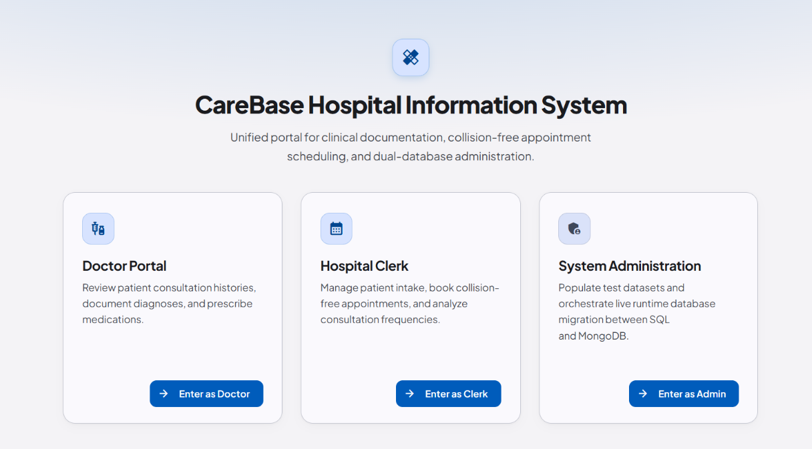

# CareBase - Hospital Information System


CareBase is a full-stack hospital management system built with an Angular 22 frontend and a Python Flask REST API. Everything runs across five Docker containers behind an Nginx reverse proxy, featuring a dual-database setup that lets you migrate data live from MariaDB to MongoDB.

This is [a refactored version of my university project](https://github.com/jakspt/carebase), which originally used server-rendered Jinja2 HTML templates for the frontend.

<p align="center">
  
</p>

## Live Demo

[**Launch the Live Demo**](https://jakspt.github.io/carebase-angular/)

Because the frontend uses a **Hexagonal Architecture (Ports and Adapters)**, the UI code only talks to an abstract `HospitalDataAccess` interface. It doesn't care where the data actually comes from.

In production, Angular injects `HttpHospitalDataAdapter` to talk to the Flask backend. For this GitHub Pages demo, it injects `InMemoryHospitalDataAdapter` instead. This adapter runs entirely in the browser using static mock data (doctors, patients, and appointments), which makes it easy to test the UI and host a fast live preview without spinning up backend or database containers.

## Quick Setup (Run Locally)

**Prerequisites:** Docker and Docker Compose

1. **Clone the repository**:

   ```bash
   git clone https://github.com/jakspt/carebase.git
   cd carebase
   ```

2. **Start the containers**:

   ```bash
   docker compose up
   
   ```

3. **Open the app**:
   Go to <http://localhost> in your browser.

## Key Highlights

CareBase focuses on three main areas of full-stack engineering:

* **Modern Angular Frontend**: An Angular 22 Single Page Application (SPA) using Signals for state management, a Ports and Adapters architecture for clean data fetching, Angular Material for accessible UI components, and Vitest for component testing.

* **SQL-to-NoSQL Data Migration**: The backend can switch from a relational database (MariaDB) to a document database (MongoDB) on the fly using the Strategy Pattern, migrating all existing records automatically.

* **Containerized Infrastructure**: A 5-container Docker Compose setup that uses healthchecks to manage startup order, Nginx for routing, and persistent volumes for database storage.

## User Roles & Features

| Role | What They Do | Key Actions in the App |
| ----- | ----- | ----- |
| **Doctor** | Manage patient medical histories, treatments, and prescriptions. | Search patients by name or SSN, view past appointments, and log new treatments with prescribed medications and costs. |
| **Clerk** | Handle appointment scheduling and view hospital statistics. | Search doctors and patients, book 30-minute slots (with automatic double-booking prevention), and view Consultation Frequency Reports. |
| **Admin** | Manage demo test data and control the active database. | Generate fake clinical data in MariaDB using `faker`, trigger the live migration to MongoDB, and toggle the active database driver. |

## System Architecture

An Nginx reverse proxy sits in front of the app, sending normal page requests to the Angular container and `/api/` requests to the Flask backend.

```
flowchart TD
    Client["Client Browser"] -->|"HTTP :80"| Nginx["Nginx Reverse Proxy (:80)"]
    Nginx -->|"Path: /"| Angular["Angular SPA (carebase_frontend:80)"]
    Nginx -->|"Path: /api/"| Flask["Flask REST API (carebase:5000)"]
    Flask -->|"Strategy Pattern"| DBStrategy["DBStrategy (Abstract Interface)"]
    DBStrategy --> MariaDBStrategy["MariaDBStrategy"]
    DBStrategy --> MongoDBStrategy["MongoDBStrategy"]
    MariaDBStrategy -->|"Relational Driver"| MariaDB[("MariaDB (:3306)")]
    MongoDBStrategy -->|"NoSQL Driver"| MongoDB[("MongoDB (:27017)")]

```

## Technical Under-the-Hood

### Frontend (Angular 22)

* **State Management with Signals**: Uses Angular Signals (`signal`, `computed`, `resource`) for reactive UI updates without the boilerplate of manual RxJS subscriptions.

* **Hexagonal Architecture (Ports & Adapters)**: Components fetch data through the `HospitalDataAccess` port. This keeps API logic separate from UI logic and lets us easily swap between `HttpHospitalDataAdapter` (production) and `InMemoryHospitalDataAdapter` (testing and static demos).

* **Accessible UI**: Built with Angular Material and designed for data-heavy medical workflows while meeting WCAG AA accessibility standards.

* **Realistic Component Testing**: Tested with Vitest and Angular Material test harnesses. Instead of mocking internal component methods, tests interact with the actual DOM and use in-memory adapter stubs.

### Database & Migration (MariaDB & MongoDB)

* **Runtime Database Switching**: The Flask backend uses an abstract `DBStrategy` interface. From the admin dashboard, you can switch the active database from `MariaDBStrategy` to `MongoDBStrategy` at runtime without restarting the server.

* **Automated SQL-to-NoSQL Migration**: A built-in migration script converts normalized SQL tables from MariaDB into nested MongoDB documents, turning foreign-key relationships into embedded arrays and sub-documents.

* **Pre-Computed Analytics (MongoDB Computed Pattern)**: Calculating a doctor's yearly earnings in MongoDB would normally require slow `$unwind` aggregations across nested patient arrays. Instead, CareBase stores a pre-calculated total (`kosten_pro_jahr.<year>`) directly on each Doctor document. Whenever a new treatment is saved, both the patient's record and the doctor's yearly total update together, keeping report reads at $O(1)$.

* **Hybrid Appointment Storage**: In MongoDB, appointments are embedded inside Patient documents so a patient's full medical history loads in a single read. At the same time, a separate top-level `Appointment` collection tracks time slots so clerks can quickly check for 30-minute scheduling conflicts without scanning every patient record.

### DevOps & Docker Setup

* **5-Container Stack**: Managed via [compose.yaml](compose.yaml), running `nginx`, `frontend` (Angular), `web` (Flask), `mariadb`, and `mongodb`.

* **Smart Startup Order**: Docker healthchecks ensure the Flask API (`web`) waits until both `mariadb` and `mongodb` are fully ready and accepting connections before starting up.

* **Nginx Reverse Proxy**: Listens on port 80, routing `/api/` calls to Flask and everything else (`/`) to the Angular app, complete with SPA fallback routing and 120s proxy timeouts.

* **Persistent Volumes**: Uses `mariadb_data` and `mongodb_data` volumes so your database records survive container restarts.

## Screenshots & Workflows

*Figure 1: Clerk scheduling view with a multi-step booking form and live 30-minute time slot checks.*

*Figure 2: Analytics dashboard showing consultation frequency reports and yearly doctor earnings.*

## Running Tests & Code Checks

You can run the frontend test suite, TypeScript checks, and code formatting from the root folder:

```bash
# Run frontend unit and component tests
npm --prefix frontend/carebase-frontend run test:run

# Check TypeScript types
npm --prefix frontend/carebase-frontend run typecheck

# Check formatting with Prettier
npx --prefix frontend/carebase-frontend prettier --check README.md

# Run pre-commit checks on staged files
npx --prefix frontend/carebase-frontend lint-staged

```

Husky pre-commit hooks automatically run formatting, type checks, and tests before every commit.

## How the Project Evolved

CareBase started as a university project built as a monolithic Python Flask app with server-rendered Jinja2 templates and Bootstrap CSS. That first version proved that the database Strategy Pattern and SQL-to-NoSQL migration worked well, but having the UI tightly coupled to the Python backend made state management, dynamic UI updates, and frontend testing harder than they needed to be.

To turn it into a production-style portfolio project, I extracted the frontend and rebuilt it from scratch as an Angular 22 Single Page Application. Moving to Angular allowed me to add Signals for cleaner state management, a Ports and Adapters architecture for decoupled data fetching, Vitest component tests, and an Nginx reverse proxy to tie the stack together.
