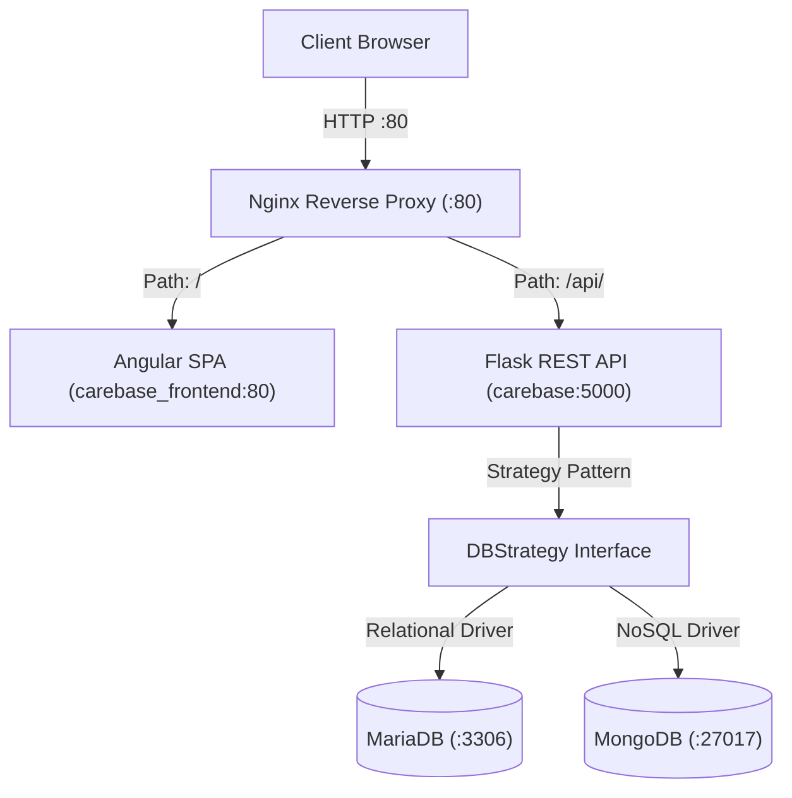

# CareBase - Hospital Information System


CareBase is a hospital information system designed to demonstrate enterprise web architecture, polyglot persistence, and containerized deployment. The application couples a modern Angular 22 Single Page Application with a Python Flask REST API, orchestrated across five Docker containers behind an Nginx reverse proxy.

## Live Demonstration

The application can be evaluated immediately without local installation:

**[Launch Live Demo](https://jakspt.github.io/carebase)**

<details>
<summary>Architectural Note: Zero-Backend Static Client Bundle</summary>

CareBase implements Hexagonal Architecture (Ports and Adapters) at the frontend data boundary. Component and feature layers depend strictly on the abstract `HospitalDataAccess` port (`HOSPITAL_DATA_ACCESS` injection token).

In the containerized production stack, Angular Dependency Injection provides `HttpHospitalDataAdapter`, which dispatches HTTP requests to the Flask REST API. For the static live demonstration hosted on GitHub Pages, the application configures `InMemoryHospitalDataAdapter`. This adapter fulfills the identical port contract entirely in memory using reactive Angular Signals, enabling complete clinical workflows (patient search, conflict-free appointment scheduling, treatment documentation, and analytics reports) with zero server or database dependencies.

</details>

## Executive Summary

CareBase demonstrates end-to-end full-stack software engineering across three foundational technical pillars:

- **Modern Angular Architecture**: Angular 22 Single Page Application built on fine-grained reactive Signals, Hexagonal Architecture with decoupled Ports and Adapters, an accessible Angular Material design system, and Vitest component test harnesses.
- **Polyglot Persistence & Data Migration**: Runtime Strategy Pattern enabling zero-downtime persistence switching between relational MariaDB and document-oriented MongoDB, supported by an automated one-way migration engine and MongoDB performance optimization patterns.
- **DevOps & Multi-Container Infrastructure**: 5-container Docker Compose topology orchestrated with healthcheck dependency chains, Nginx reverse proxy routing, and persistent volume storage.

## System Architecture

The containerized topology separates client delivery, API routing, application logic, and polyglot persistence layers behind an Nginx gateway.



## Engineering Deep Dives

### Frontend Architecture

- **Fine-Grained Reactivity**: State management and asynchronous data lifecycles rely on Angular Signals (`signal`, `computed`, `resource`), ensuring optimal change detection performance and reactive data propagation without manual RxJS subscription handling.
- **Hexagonal Architecture (Ports & Adapters)**: Frontend domain logic interacts with data access boundaries through the `HospitalDataAccess` port. The system decouples consumers from transport details, allowing `HttpHospitalDataAdapter` and `InMemoryHospitalDataAdapter` to be swapped seamlessly across production, testing, and static preview environments.
- **Enterprise Design System**: Clinical interfaces are built with Angular Material components styled for high-density medical workflows while maintaining WCAG AA accessibility compliance.
- **Component Test Rigor**: Test suites leverage Vitest and Angular CDK/Material component test harnesses (`MatAutocompleteHarness`, `MatStepperHarness`) with zoneless asynchronous stabilization (`await fixture.whenStable()`). Direct method spying on hexagonal ports is prohibited in favor of realistic adapter stubs and observable DOM interactions. Refer to [ADR 0003: Frontend Testing Standards and Harnesses](docs/adr/0003-frontend-testing-standards-and-harnesses.md).

### Database Engineering & Migration

- **Runtime Strategy Pattern**: All database interactions are mediated by an abstract `DBStrategy` interface in the Flask backend. The active implementation (`MariaDBStrategy` or `MongoDBStrategy`) can be swapped at runtime via the administrative interface without restarting the application container.
- **Automated One-Way Migration**: An integrated migration pipeline transforms normalized relational tables from MariaDB into denormalized, document-oriented MongoDB collections, automatically re-structuring relational foreign keys into embedded document hierarchies. Refer to [ADR 0001: One-Way Migration and Independent SQL Seeding](docs/adr/0001-one-way-migration-and-independent-sql-seeding.md).
- **MongoDB Computed Pattern**: To avoid costly aggregation pipelines (`$unwind` operations across nested appointment and treatment arrays) during reporting queries, doctor yearly earnings are pre-computed directly on Doctor documents (`kosten_pro_jahr.<year>`). Every new treatment write atomically updates both the patient record and the doctor's pre-computed total, ensuring $O(1)$ read performance for the Doctor Earnings Report. Refer to [ADR 0002: MongoDB Computed Pattern for Doctor Earnings](docs/adr/0002-mongodb-computed-pattern-for-doctor-earnings.md).
- **Hybrid Appointment Collection**: Appointments are embedded within Patient documents for immediate chronological medical history retrieval. Concurrently, a dedicated root `Appointment` collection is maintained in MongoDB to facilitate fast 30-minute time slot collision detection during clerk scheduling without scanning all patient documents.

### DevOps & Multi-Container Infrastructure

- **5-Service Container Topology**: Orchestrated using [compose.yaml](compose.yaml), coordinating `nginx` (reverse proxy), `frontend` (Angular SPA), `web` (Flask REST API), `mariadb` (relational database), and `mongodb` (document database).
- **Healthcheck Dependency Chains**: Service startup order is enforced through health checks. The `web` service waits for `condition: service_healthy` on both `mariadb` (`healthcheck.sh`) and `mongodb` (`mongosh ping`) prior to starting API workers.
- **Reverse Proxy Routing**: Nginx operates as the central entrypoint on port 80, routing API traffic (`/api/`) to the Flask container and all client routes (`/`) to the Angular SPA, with configured proxy timeouts (120s) and SPA route fallback handling.
- **Persistent Data Storage**: Database volumes (`mariadb_data` and `mongodb_data`) guarantee data persistence across container rebuilds and teardowns.

## User Interface & Clinical Workflows


_Figure 1: Clerk appointment scheduling interface featuring multi-step intake and real-time 30-minute time slot availability._


_Figure 2: Clinical analytics dashboard visualizing Consultation Frequency Reports and doctor yearly earnings._

## Quickstart

### Prerequisites

- Docker and Docker Compose

### 3-Step Setup

1. **Clone the repository**:

   ```bash
   git clone https://github.com/jakspt/carebase.git
   cd carebase
   ```

2. **Start the multi-container stack**:

   ```bash
   docker compose up
   ```

3. **Access the application**:
   Open [http://localhost](http://localhost) in your browser.

### User Role Matrix

| Role       | Domain Scope & Core Capabilities                                                                              | Primary Clinical Actions                                                                                                                            |
| :--------- | :------------------------------------------------------------------------------------------------------------ | :-------------------------------------------------------------------------------------------------------------------------------------------------- |
| **Doctor** | Review patient medical histories, manage treatment records, and prescribe medications.                        | Search patients by name or SSN, view chronological appointment histories, record clinical treatments with medications and associated costs.         |
| **Clerk**  | Manage patient scheduling and view administrative consultation analytics.                                     | Search available doctors and patients, reserve 30-minute time slots with conflict-free collision detection, inspect Consultation Frequency Reports. |
| **Admin**  | Manage infrastructure demonstration state, synthetic test data generation, and runtime persistence migration. | Seed synthetic clinical data into MariaDB using `faker`, execute live one-way migration to MongoDB, swap active runtime persistence strategy.       |

## Verification & Testing

The frontend test suite validates components, services, and integration workflows using Vitest:

```bash
# Execute frontend unit and harness tests
cd frontend/carebase-frontend
npm run test:run
```

From the repository root, the test suite can also be executed directly:

```bash
npm --prefix frontend/carebase-frontend run test:run
```

Repository guardrails enforce code quality, Prettier formatting, and TypeScript compilation before commits are accepted.

## Architecture Evolution

CareBase originated as an academic proof-of-concept exploring dual-database persistence in a monolithic Python Flask application using server-rendered Jinja2 templates and Bootstrap CSS. While this initial prototype validated the database Strategy Pattern and data migration mechanics, coupling presentation directly to the server framework created friction in state management, responsive UI updates, and automated testability.

To elevate the system to enterprise standards, the presentation layer was extracted and completely redesigned into a decoupled Angular 22 Single Page Application. This architectural evolution introduced fine-grained reactivity with Angular Signals, Hexagonal Architecture to isolate data access concerns, comprehensive component test harnesses using Vitest, and an Nginx reverse proxy architecture. The result is a scalable, decoupled system demonstrating both polyglot database design and modern frontend engineering practices.
