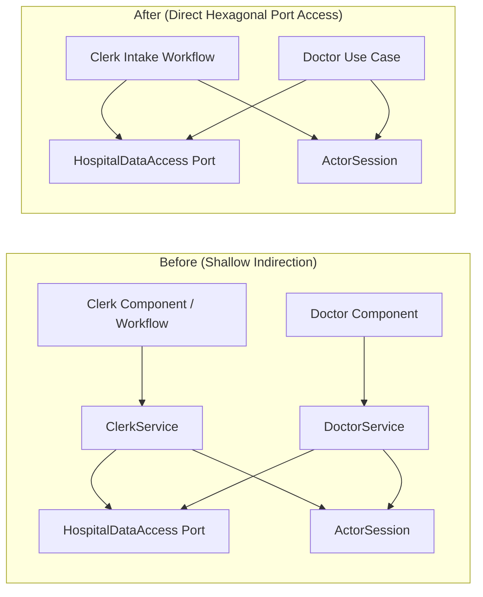
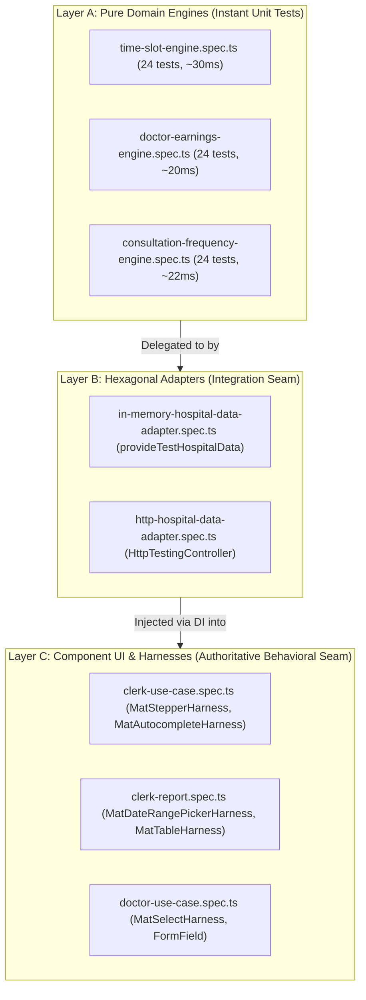

# ADR 0005: Frontend Deepening, Seam Simplification, and Pure Domain Engines

## Status

Accepted (Implemented)

## Context & Problem Statement

As the CareBase Angular frontend evolved toward Angular Signals and hexagonal architecture, structural bloat, artificial component seams, and redundant indirection accumulated across core feature modules:

1. **Legacy Shallow Forwarder Services (`DoctorService`, `ClerkService`)**:
   `DoctorService` and `ClerkService` acted as zero-logic pass-through proxies over the `HOSPITAL_DATA_ACCESS` hexagonal port and `ActorSession`. They provided no domain transformations, caching, or business invariants, yet required dedicated unit test suites (`clerk-service.spec.ts`) that tested nothing beyond forwarder passthrough. This indirection obscured the hexagonal architecture and added cognitive load for developers navigating data flows.

2. **Monolithic In-Memory Adapter Entanglement**:
   The `InMemoryHospitalDataAdapter` entangled Angular reactive primitives (`signal`, `resource`, `linkedSignal`) with three mathematically complex domain algorithms:
   - 30-minute Time Slot calculation between 08:00 and 17:00, conflict detection against existing doctor/patient schedules, and 14-day forward lookahead window when fully booked.
   - Doctor earnings aggregation across historical treatments by calendar year.
   - Consultation frequency aggregation across patient-doctor combinations over arbitrary date ranges.
   Because these algorithmic engines were embedded directly inside the reactive adapter class, testing calculation edge cases (e.g., leap years, boundary timestamps, cross-midnight queries, full-window exhaustion) required heavy Angular TestBed setups, asynchronous resource resolution, and artificial microtask settling.

3. **Artificial Seam and Alias Explosion in Appointment Intake**:
   The Appointment Intake feature (`ClerkUseCase`) was split across a view component and a headless `AppointmentIntakeWorkflow` service. Instead of exposing the workflow directly to the template, `ClerkUseCase` maintained approximately 60 redundant signal getters and forwarding methods (`selectedPatient()`, `selectPatient()`, `selectedDoctor()`, `selectDoctor()`, `timeSlots()`, etc.). This artificial seam caused extreme code duplication: modifying a single signal in the workflow required updating three files (workflow, component class, and component template).

4. **Duplicate Test Suites and Test Bloat**:
   Appointment intake was tested twice through separate test suites: once through `appointment-intake-workflow.spec.ts` (testing multi-step intake flows headlessly) and once through `clerk-use-case.spec.ts` (testing the exact same multi-step intake flows via Angular CDK Material harnesses against the DOM). This duplication inflated the test surface to over 1,190 lines and slowed CI test execution.

5. **Domain Vocabulary Divergence**:
   The data access port interface and in-memory adapter used `PatientVisitsReport` and `getPatientVisitsReport`, violating the project's canonical domain glossary (`GLOSSARY.md`), which mandates **Consultation Frequency Report** and explicitly warns: `_Avoid_: Visit Frequency Report, Visit report, Besuchsbericht, Patient visits report`.

---

## Options Considered

### Option 1: Status Quo (Tolerate Indirection and Monolithic Adapter)
- **Pros**: Zero initial refactoring effort; existing tests remain untouched.
- **Cons**: Ongoing maintenance friction, test execution drag, ~600 lines of redundant boilerplate, risk of regression when touching entangled adapter algorithms, continued violation of the canonical domain glossary.

### Option 2: Angular-Bound Sub-Services and Shallow Delegation
- **Approach**: Break up `InMemoryHospitalDataAdapter` by extracting `TimeSlotService`, `EarningsCalculationService`, and `ConsultationFrequencyService` as `@Injectable()` classes within Angular DI. Retain `DoctorService` and `ClerkService` as facades.
- **Pros**: Modularizes the in-memory adapter; maintains existing component class forwarders.
- **Cons**: Keeps calculation algorithms coupled to the Angular runtime and dependency injector. Unit tests still require Angular TestBed or mock injection. Fails to eliminate the ~60 forwarding aliases in `ClerkUseCase`.

### Option 3: Deep Hexagonal Adapters, Pure Domain Engines, and Direct View Bindings (Selected)
- **Approach**:
  1. Permanently delete `DoctorService` and `ClerkService`, directing consumers straight to `HOSPITAL_DATA_ACCESS` and `ActorSession`.
  2. Extract algorithmic calculations into pure TypeScript functions with zero Angular dependencies (`time-slot-engine.ts`, `doctor-earnings-engine.ts`, `consultation-frequency-engine.ts`).
  3. Deepen the in-memory adapter by delegating internal calculations to these pure engines while preserving 100% of the public hexagonal port interface (`HospitalDataAccess`).
  4. Collapse the artificial component seam in Appointment Intake by binding the template directly to `workflow.*`, while retaining clean multi-file separation for view/DOM concerns.
  5. Align report terminology with `GLOSSARY.md` (`ConsultationFrequencyReport`), retaining backwards-compatible aliases.
  6. Consolidate test suites around authoritative CDK harnesses per ADR 0003 while testing domain engines with instant pure unit tests.
- **Pros**: Maximum test speed and isolation; net reduction of ~600 lines of code; elimination of brittle forwarder aliases; strict compliance with hexagonal architecture and project glossary.

---

## Decisions

### 1. Permanent Retirement of Shallow Forwarder Services

`DoctorService` and `ClerkService` are permanently removed from the codebase along with `clerk-service.spec.ts`.
- **Consumer Directness**: Feature components and workflows (`DoctorUseCase`, `DoctorReport`, `AppointmentIntakeWorkflow`, `ClerkReport`) inject `ActorSession` for current authenticated actor identity and `HOSPITAL_DATA_ACCESS` for data operations.
- **Rationale**: Eliminating zero-logic forwarders removes unnecessary layers of indirection, clarifies architectural boundaries, and deletes over 260 lines of dead forwarding code.



### 2. Extraction of Pure Domain Calculation Engines

Mathematical and algorithmic calculations are extracted from adapter classes into pure, standalone domain engine modules located under `src/app/services/`:

1. `time-slot-engine.ts`:
   - `calculateTimeSlots(appointments, params)`: Computes available 30-minute slots between 08:00 and 17:00 (19 slots/day), excludes slots conflicting with the doctor or patient, and computes the `nextAvailableDate` using a 14-day forward lookahead window when the requested date is fully booked.
2. `doctor-earnings-engine.ts`:
   - `calculateDoctorEarnings(doctors, appointments, year)`: Aggregates total treatment costs for each doctor for a specified calendar year.
3. `consultation-frequency-engine.ts`:
   - `calculateConsultationFrequency(appointments, patients, doctors, range)`: Aggregates visit counts per unique patient-doctor pair across a given date range.

**Engine Characteristics**:
- **Zero Angular Dependencies**: No imports from `@angular/core`, `@angular/common`, or RxJS.
- **Determinism**: Operates purely on immutable input data and returns plain JavaScript objects.
- **Instant Execution**: Edge cases can be tested in sub-millisecond durations without DOM emulation or microtask loops.

### 3. Deepening of Hexagonal In-Memory Adapter

`InMemoryHospitalDataAdapter` continues to implement `HospitalDataAccess` and remains available via `provideTestHospitalData()`. However, its internal implementation is deepened:
- The adapter acts strictly as an orchestration layer managing reactive state (`signal`, `resource`, `linkedSignal`), version bumping, and in-memory fixture storage.
- All query calculation logic delegates directly to the pure calculation engines:

```typescript
// Example: InMemoryHospitalDataAdapter delegating to pure calculation engine
getTimeSlots(paramsSignal) {
  return resource({
    params: () => ({ params: paramsSignal(), version: this.appointmentsVersion() }),
    loader: async ({ params }) => {
      if (!params.params?.date || !params.params?.doctorSsn) return undefined;
      return calculateTimeSlots(this.appointments, params.params);
    },
  });
}
```

### 4. Seam Collapse and Direct Template Bindings in Appointment Intake

The multi-file separation between `AppointmentIntakeWorkflow` (state, validation, and async orchestration) and `ClerkUseCase` (view template, CSS, and DOM interaction) is retained. However, the artificial forwarder seam is eliminated:
- **Direct Template-to-Workflow Bindings**: The view template (`clerk-use-case.html`) binds directly to properties and methods on `workflow` (e.g., `workflow.selectedPatient()`, `workflow.selectPatient(p)`, `workflow.canProceedFromStep1()`).
- **Lean Component Class**: `ClerkUseCase` class shrank from 232 lines to 105 lines, retaining only DOM-level responsibilities:
  - Material Stepper reset and animation handling (`stepper.reset()`).
  - View child element focusing (`clerkInput()?.nativeElement.focus()`).
  - Form submission dispatch (`submit(...)`).
  - Autocomplete display formatters (`displayPatient`, `displayDoctor`).

### 5. Alignment with Canonical Domain Glossary

The data access port interface, in-memory adapter, HTTP adapter, and report consumer components are aligned with `GLOSSARY.md`:
- `PatientVisitsReport` is canonically renamed to `ConsultationFrequencyReport`.
- `getPatientVisitsReport` is canonically renamed to `getConsultationFrequencyReport`.
- A backwards-compatible alias `export type PatientVisitsReport = ConsultationFrequencyReport;` and optional delegation method `getPatientVisitsReport?` are maintained on the port interface to ensure zero breaking changes for existing external consumers.

---

## Testing Boundaries & Standards

CareBase establishes three explicit, non-overlapping testing seams:



### Layer A: Pure Calculation Engine Seam (Zero Mocks, Zero DI)
- **Scope**: Algorithmic rules, 30-minute interval math, 14-day lookahead boundaries, year filtering, patient-doctor aggregation, conflict detection.
- **Rule**: Pure TypeScript tests executing synchronously. Zero Angular TestBed, zero Zone.js, zero mocks, zero spies.
- **Authoritative Coverage**: 72 pure domain unit tests executing in ~72ms total.

### Layer B: Hexagonal Adapter Seam (`provideTestHospitalData()`)
- **Scope**: Hexagonal contract fulfillment, reactive signal/resource loading, optimistic version bumping, mutation error mapping (`BookingConflictError`, `PatientNotFoundError`).
- **Rule**: Tests instantiate adapters via Angular DI or `provideTestHospitalData()`. Infrastructure failure modes are tested via adapter stubs or method reassignment with guaranteed restoration in `finally` blocks (respecting ADR 0003 prohibitions against `vi.spyOn`).

### Layer C: Angular CDK Component Harness Seam (ADR 0003 Authoritative Tests)
- **Scope**: Complete user-facing interaction flows, DOM rendering, stepper progression, form validation, error snackbar displays.
- **Rule**: Tests interact strictly through Angular Material Component Harnesses (`MatAutocompleteHarness`, `MatStepperHarness`, `MatSelectHarness`, `MatButtonHarness`) against DOM elements using `await fixture.whenStable()`.
- **Deduplication Policy**: Multi-step user journey scenarios are authoritative in the component test suite (`clerk-use-case.spec.ts`). Headless workflow unit tests (`appointment-intake-workflow.spec.ts`) are restricted to isolated state-machine transitions, preventing duplicate multi-step flow assertions.

---

## Consequences & Impact

### Positive Consequences
- **Codebase Simplification**: Over 600 lines of dead forwarders, pass-through aliases, and duplicate tests were permanently purged from the repository.
- **Lightning-Fast Domain Verification**: 72 exhaustive unit tests across three pure domain engines run in ~72ms, enabling rapid TDD iterations without Angular compilation or DOM overhead.
- **High Architectural Cohesion**: Adapters orchestrate reactive signals; pure engines compute domain logic; components manage DOM and user interactions; workflows manage step state.
- **Maintainability & Refactoring Safety**: Adding or modifying an intake field no longer requires synchronizing ~60 forwarding getter/setter pairs across component and workflow.
- **Canonical Consistency**: Terminology directly reflects `GLOSSARY.md`, avoiding deprecated phrases like "Patient visits report".

### Neutral Consequences & Trade-offs
- **Direct Template References**: The component HTML template references `workflow.<field>()` directly, requiring developers to recognize `workflow` as the public state context for intake steps.
- **Dual Test Files for Pure Engines**: New engine test files (`*-engine.spec.ts`) exist side-by-side with engine source files, but execute with negligible runtime cost.

### Quantitative Summary

| Metric | Before Refactoring | After Refactoring | Net Difference |
| :--- | :--- | :--- | :--- |
| **`ClerkUseCase` Component Class** | 232 lines | 105 lines | **-127 lines (-55%)** |
| **Shallow Forwarder Services** | 94 lines (`DoctorService`, `ClerkService`) | 0 lines (Deleted) | **-94 lines (-100%)** |
| **Shallow Forwarder Tests** | 174 lines (`clerk-service.spec.ts`) | 0 lines (Deleted) | **-174 lines (-100%)** |
| **Monolithic Adapter Entanglement** | ~154 lines inline logic | Deepened delegation | **-90 lines pruned from adapter** |
| **Workflow Test Duplication** | 146 lines (duplicate flow assertions) | 67 lines (isolated state checks) | **-79 lines (-54%)** |
| **Pure Domain Unit Tests** | 0 tests | 72 tests (`time-slot`, `doctor-earnings`, `consultation-frequency`) | **+72 instant unit tests** |
| **Pure Engine Execution Time** | N/A (tested via async resource) | ~72ms (all 72 tests combined) | **Sub-millisecond per test** |
| **Total Test Suite Health** | 327 passing tests | 327 passing tests (23 suites) | **0 regressions, 100% passing** |
