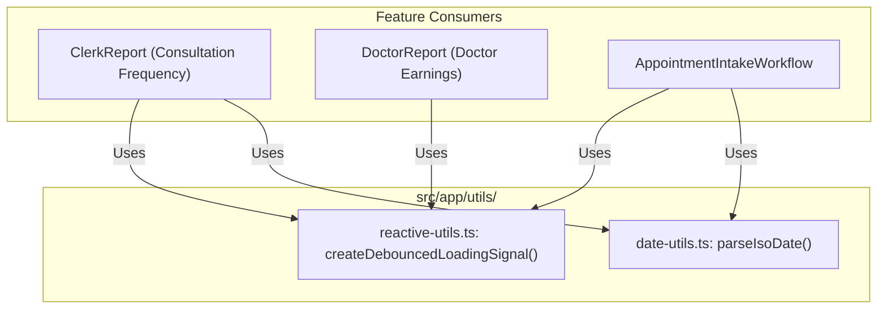
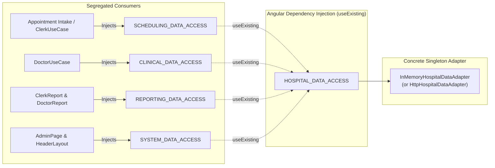
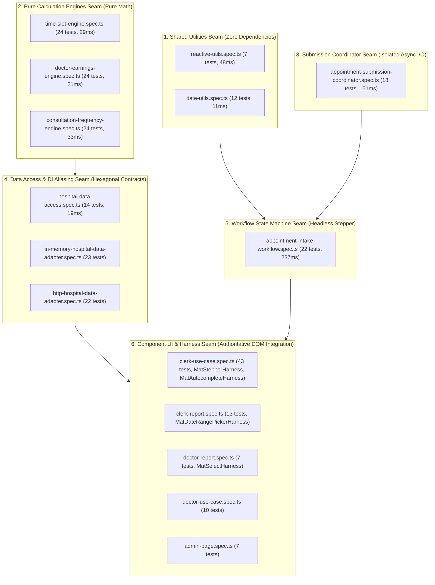

# ADR 0006: Data Access Interface Segregation, Workflow Decomposition, and Adapter Deepening

## Status

Accepted (Implemented)

## Context & Problem Statement

Following the foundational deepening and domain engine extraction established in ADR 0005, analysis of the CareBase Angular frontend identified lingering structural monoliths, interface segregation violations, and domain terminology divergence:

1. **Monolithic Appointment Intake Workflow (~430 LOC)**:
   The `AppointmentIntakeWorkflow` service accumulated multiple competing responsibilities into a single 430-line class. It simultaneously managed reactive stepper state for a 4-step intake wizard, inlined ad-hoc date parsing helpers, maintained an RxJS debouncing bridge for patient search, and contained an 85-line asynchronous submission engine coordinating payload construction, 409 conflict detection, slot re-querying callbacks, and error message resolution. This tangled state machine and asynchronous I/O made headless workflow testing brittle and bloated.

2. **Duplicated Progress Indicator Logic**:
   The reactive debounced loading indicator pattern used in the appointment intake workflow was duplicated verbatim across administrative reports (`ClerkReport` / Consultation Frequency Report) and financial analytics (`DoctorReport` / Doctor Earnings Report). Each component independently instantiated RxJS `timer`, `switchMap`, and `toObservable`/`toSignal` pipelines to suppress UI spinner flicker during fast queries, violating DRY principles and creating maintenance drag.

3. **Flat Services Directory Congestion**:
   The `src/app/services/` directory housed 17 flat files combining pure mathematical engines (`time-slot-engine`, `doctor-earnings-engine`, `consultation-frequency-engine`), hexagonal port contracts (`hospital-data-access`), concrete HTTP and in-memory persistence adapters, mock fixture generators, cross-cutting authentication sessions (`actor-session`), and operation runner services. This lack of sub-domain boundaries increased cognitive overhead for contributors.

4. **Monolithic Data Access Port Violating Interface Segregation Principle (ISP)**:
   The master `HospitalDataAccess` interface exposed nine disparate operations spanning Scheduling, Clinical Care, Financial/Administrative Reporting, and System Database Administration. Feature components were forced to depend on operations completely unrelated to their use cases:
   - Appointment Intake depended on clinical treatment recording and database migration.
   - Doctor Clinical Views depended on clerk search, appointment booking, and database seeding.
   - Administrative and Doctor Reports depended on appointment mutation methods.
   This lack of capability segregation blurred architectural boundaries and impeded targeted mocking in component tests.

5. **Boilerplate Resource Declarations and Fragile Mock Primitives**:
   The `InMemoryHospitalDataAdapter` contained repetitive `resource(...)` declaration boilerplate across 9 query endpoints, manually wiring injectors, parameters, and version signals. Furthermore, to simulate loading states for database status queries, the adapter constructed a fragile, synthetic 20-line mock resource object with dummy signals, violating standard Angular `ResourceRef` contracts.

6. **Domain Vocabulary Divergence**:
   In violation of the canonical domain glossary (`GLOSSARY.md`), which mandates "Appointment" and strictly forbids "Booking" (`_Avoid_: Termin, Booking, Reservation, Visit`), several components, workflow models, and error classes retained legacy booking terminology (`bookingForm`, `BookingResult`, `BookingConflictError`).

---

## Options Considered

### Option 1: Status Quo (Tolerate Monoliths and Flat Services)
- **Approach**: Retain the 430-line appointment intake workflow, leave loading spinner logic duplicated across reports, maintain the flat services directory, and continue using the monolithic data access port.
- **Pros**: Zero immediate refactoring effort; existing imports and test suites remain untouched.
- **Cons**: High cognitive load; violates Interface Segregation Principle; duplicates reactive timer pipelines; preserves fragile 20-line mock resource primitives; perpetuates non-standard domain vocabulary ("Booking").

### Option 2: Split In-Memory Adapter into Multiple Discrete Classes
- **Approach**: Break `InMemoryHospitalDataAdapter` into four independent adapter classes (`InMemorySchedulingAdapter`, `InMemoryClinicalAdapter`, `InMemoryReportingAdapter`, `InMemorySystemAdapter`), each managing its own isolated fixture state.
- **Pros**: Matches interface segregation at the physical class level.
- **Cons**: **Rejected**. Introduces critical state synchronization hazards: appointments created by the scheduling adapter must immediately reflect in clinical history queries and reporting aggregation. Maintaining multiple isolated in-memory stores requires pub/sub event buses or redundant state-sharing bridges, creating fragility in offline demo and testing modes without delivering real architectural value.

### Option 3: Interface Segregation via Capability Tokens, Sub-Domain Services Layout, Shared Utilities, and Submission Coordinator Extraction (Selected)
- **Approach**:
  1. Extract reusable reactive debounced loading signals and ISO date parsing into dedicated shared utility modules under `src/app/utils/`.
  2. Partition `src/app/services/` into `engines/` and `data-access/` subdirectories, unified by a root barrel re-export for full backward compatibility.
  3. Segregate `HospitalDataAccess` into four capability interfaces (`SchedulingDataAccess`, `ClinicalDataAccess`, `ReportingDataAccess`, `SystemDataAccess`) with individual Angular `InjectionToken`s aliased via Angular's `useExisting` provider pattern.
  4. Preserve `InMemoryHospitalDataAdapter` as a unified, deep singleton implementing the composite contract, while eliminating repetitive resource boilerplate and replacing the fragile fake mock resource with standard `resource` semantics.
  5. Decouple the 85-line asynchronous submission and conflict-recovery engine into an injectable `AppointmentSubmissionCoordinator`, shrinking `AppointmentIntakeWorkflow` below 280 LOC.
  6. Align domain naming with `GLOSSARY.md` (`AppointmentConflictError`, `appointmentForm`), preserving backward-compatible aliases for templates.
- **Pros**: Adheres strictly to the Interface Segregation Principle; unified in-memory persistence ensures synchronization; isolates async conflict orchestration; provides zero-dependency sub-millisecond utility testing; guarantees 100% backward compatibility with zero regressions.

---

## Decisions

### 1. Shared Reactive and Date Utilities

Reusable reactive and date logic is extracted into pure, standalone utilities located in `src/app/utils/`:

- **`createDebouncedLoadingSignal(isLoading, delayMs = 250, options?)`** (`src/app/utils/reactive-utils.ts`):
  Accepts an active loading signal and returns a debounced boolean signal. If `isLoading` remains true for the threshold duration (default 250ms), the debounced signal emits `true` to display a progress indicator. If `isLoading` resolves quickly (sub-250ms), the debounced signal never emits `true`, preventing UI spinner flicker. When `isLoading` transitions to `false`, the debounced signal emits `false` immediately without delay. Configurable with an optional custom `Injector` for non-injection contexts.
- **`parseIsoDate(target: string | Date)`** (`src/app/utils/date-utils.ts`):
  Converts a date string (`YYYY-MM-DD` or full ISO) or `Date` object into a normalized `Date` instance with time zeroed to local midnight (`00:00:00.000`), avoiding time-zone skew in date comparisons.
- **Consumer Deduplication**:
  `ClerkReport` (Consultation Frequency Report), `DoctorReport` (Doctor Earnings Report), and `AppointmentIntakeWorkflow` were refactored to consume `createDebouncedLoadingSignal`, eliminating ~40 lines of duplicated RxJS pipelines across components.



### 2. Services Directory Sub-Domain Layout

The flat `src/app/services/` directory is partitioned into cohesive subdirectories according to domain responsibility:

```
src/app/services/
├── actor-session.ts
├── actor-session.spec.ts
├── operation-runner.ts
├── operation-runner.spec.ts
├── index.ts                         <-- Root barrel re-exporting all public symbols
├── services.spec.ts                 <-- Barrel contract verification tests
├── engines/                         <-- Pure mathematical domain calculation engines
│   ├── time-slot-engine.ts
│   ├── time-slot-engine.spec.ts
│   ├── doctor-earnings-engine.ts
│   ├── doctor-earnings-engine.spec.ts
│   ├── consultation-frequency-engine.ts
│   ├── consultation-frequency-engine.spec.ts
│   └── index.ts
└── data-access/                     <-- Hexagonal port contracts, capability interfaces, adapters
    ├── hospital-data-access.ts
    ├── hospital-data-access.spec.ts
    ├── in-memory-hospital-data-adapter.ts
    ├── in-memory-hospital-data-adapter.spec.ts
    ├── http-hospital-data-adapter.ts
    ├── http-hospital-data-adapter.spec.ts
    ├── mock-hospital-data.ts
    └── index.ts
```

- **Root Barrel Compatibility**: `src/app/services/index.ts` re-exports all public types, classes, functions, and injection tokens. Existing imports across the application remain valid and unmodified, ensuring seamless backward compatibility.

### 3. Data Access Interface Segregation via Capability Tokens

The monolithic `HospitalDataAccess` port contract is segregated into four focused capability interfaces adhering to the Interface Segregation Principle (ISP):

```typescript
export interface SchedulingDataAccess {
  getDoctors(): ResourceRef<Doctor[]>;
  searchPatients(query: Signal<string> | (() => string)): ResourceRef<Patient[]>;
  searchClerks(query: Signal<string> | (() => string)): ResourceRef<Clerk[]>;
  getTimeSlots(params: Signal<TimeSlotQueryParams | undefined> | (() => TimeSlotQueryParams | undefined)): ResourceRef<TimeSlotsResult | undefined>;
  bookAppointment(payload: CreateAppointmentRequest): Promise<CreateAppointmentResponse>;
  createAppointment?(request: CreateAppointmentRequest): Promise<AppointmentResult>;
}

export interface ClinicalDataAccess {
  searchPatients(query: Signal<string> | (() => string)): ResourceRef<Patient[]>;
  getPatientDetails(patientId: Signal<string | number | null> | (() => string | number | null)): ResourceRef<Patient | null>;
  getMedications(category?: Signal<string>): ResourceRef<Medication[]>;
  addTreatment(patientId: string | number, appointmentId: number, treatment: Treatment): Promise<AddTreatmentResponse>;
}

export interface ReportingDataAccess {
  getDoctorEarningsReport(year: Signal<number> | (() => number)): ResourceRef<DoctorEarningsReport | undefined>;
  getConsultationFrequencyReport(dateRange: Signal<DateRange | undefined> | (() => DateRange | undefined)): ResourceRef<ConsultationFrequencyReport | undefined>;
  getPatientVisitsReport?(dateRange: Signal<DateRange | undefined> | (() => DateRange | undefined)): ResourceRef<PatientVisitsReport | undefined>;
}

export interface SystemDataAccess {
  getDatabaseStatus(): ResourceRef<DbStatus | undefined>;
  seedDatabase(): Promise<DatabaseSeedResponse>;
  migrateDatabase(): Promise<DatabaseMigrationResponse>;
}

// Master composite port maintaining backward compatibility
export interface HospitalDataAccess
  extends SchedulingDataAccess,
    ClinicalDataAccess,
    ReportingDataAccess,
    SystemDataAccess {}
```

#### Capability Injection Tokens and `useExisting` Aliasing
Dedicated Angular `InjectionToken`s are defined for each capability:
- `SCHEDULING_DATA_ACCESS`
- `CLINICAL_DATA_ACCESS`
- `REPORTING_DATA_ACCESS`
- `SYSTEM_DATA_ACCESS`
- `HOSPITAL_DATA_ACCESS` (master port)

To guarantee that capability tokens resolve to the singleton adapter instance without instantiating duplicate services, `provideHospitalDataAccessProviders` configures Angular's `useExisting` provider recipe:

```typescript
export function provideHospitalDataAccessProviders(
  adapterType: Type<HospitalDataAccess>,
): Provider[] {
  return [
    { provide: HOSPITAL_DATA_ACCESS, useClass: adapterType },
    { provide: SCHEDULING_DATA_ACCESS, useExisting: HOSPITAL_DATA_ACCESS },
    { provide: CLINICAL_DATA_ACCESS, useExisting: HOSPITAL_DATA_ACCESS },
    { provide: REPORTING_DATA_ACCESS, useExisting: HOSPITAL_DATA_ACCESS },
    { provide: SYSTEM_DATA_ACCESS, useExisting: HOSPITAL_DATA_ACCESS },
  ];
}
```



### 4. In-Memory Adapter Deepening and Cleanup

The `InMemoryHospitalDataAdapter` is retained as a unified singleton implementing the composite `HospitalDataAccess` interface, avoiding state fragmentation while pruning internal boilerplate:

1. **Concise Query Helper (`createQueryResource`)**:
   Standardized `resource(...)` declarations across all query endpoints via a private helper method that manages injector resolution, version-tracking signals, default values, and type casting, reducing repetitive setup code across 9 queries.
2. **Elimination of Fragile Mock Resource**:
   The custom 20-line fake resource object in `getDatabaseStatus()` was removed. Under simulated loading conditions (`config.isLoading = true`), the method now returns an authentic Angular `resource` whose loader yields an unresolving promise. A custom child injector supplies a non-blocking `PendingTasks` mock to prevent Vitest/Karma test runners from hanging while awaiting stability:
   ```typescript
   getDatabaseStatus(): ResourceRef<DbStatus | undefined> {
     const customInjector = this.config?.isLoading
       ? Injector.create({
           parent: this.injector,
           providers: [
             {
               provide: PendingTasks,
               useValue: { add: () => () => {}, run: (fn: any) => fn() },
             },
           ],
         })
       : undefined;

     return this.createQueryResource(
       () => this.dbStatus(),
       async (status) => {
         if (this.config?.isLoading) {
           return new Promise<never>(() => {});
         }
         return status ? { dbType: status } : undefined;
       },
       undefined,
       customInjector,
     );
   }
   ```
3. **Canonical Conflict Error Naming**:
   Per `GLOSSARY.md`, `AppointmentConflictError` is established as the canonical error thrown during double-booking conflicts. `BookingConflictError` is exported as a backward-compatible value and type alias:
   ```typescript
   export class AppointmentConflictError extends HospitalDataError {
     constructor(message = 'Appointment scheduling conflict.', cause?: unknown) {
       super(message, cause);
       this.name = 'AppointmentConflictError';
     }
   }
   export const BookingConflictError = AppointmentConflictError;
   export type BookingConflictError = AppointmentConflictError;
   ```

### 5. Appointment Intake Workflow Decomposition

The monolithic `AppointmentIntakeWorkflow` (~430 LOC) is decomposed by extracting asynchronous submission and error recovery into a dedicated coordinator service:

1. **`AppointmentSubmissionCoordinator`** (`src/app/clerk-use-case/appointment-submission-coordinator.ts`):
   - Injects `SCHEDULING_DATA_ACCESS` and `OperationRunner`.
   - Validates submission inputs (`patient`, `doctor`, `date`, `timeSlot`, and maximum 500-character reason limit).
   - Formulates the `CreateAppointmentRequest` payload.
   - Dispatches execution through `OperationRunner.run()`.
   - Intercepts 409 scheduling conflicts (`AppointmentConflictError`, `BookingConflictError`, or HTTP status 409), triggers the optional `onConflict()` callback to refresh time slots and clear the stale selection, and maps conflict responses to `{ status: 'conflict' }`.
   - Resolves user-friendly error messages for network or server failures.
2. **Focused `AppointmentIntakeWorkflow` (< 280 LOC)**:
   - Shrank from ~430 lines to 270 lines (a 37% code reduction).
   - Focuses strictly on reactive stepper UI state: step index signals, department filtering, doctor selection with `linkedSignal` resets, patient query filtering, and form validation signals.
   - Injects `SCHEDULING_DATA_ACCESS` instead of the monolithic `HOSPITAL_DATA_ACCESS`.
   - Delegates submission orchestration to `AppointmentSubmissionCoordinator.submit()`, passing an `onConflict` handler that re-queries slot availability:
     ```typescript
     async submit(): Promise<AppointmentResult> {
       return this.coordinator.submit({
         patient: this.selectedPatient(),
         doctor: this.selectedDoctor(),
         clerk: this.actorSession.currentClerk(),
         date: this.selectedDateIso(),
         timeSlot: this.selectedTimeSlot(),
         reason: this.appointmentNotes(),
         onConflict: async () => {
           this.selectedTimeSlot.set(null);
           this.timeSlotsResource.reload();
         },
       });
     }
     ```
3. **Terminology Standardization**:
   Properties are canonically renamed to `appointmentForm` and `appointmentNotes`. Deprecated accessors (`bookingForm`) are preserved with backward-compatible delegation to maintain 100% template compatibility.

---

## Testing Boundaries & Standards

CareBase establishes six distinct, non-overlapping testing seams ensuring complete behavioral verification with rapid feedback cycles:



### Seam 1: Shared Utilities (Zero Angular Dependencies)
- **Scope**: Debounced loading emissions, instant reset on false, custom injector override, ISO date normalizations with zeroed time.
- **Characteristics**: Instant pure TypeScript execution with zero DOM overhead.

### Seam 2: Pure Domain Engines (ADR 0005)
- **Scope**: Algorithmic calculations for 30-minute time slot generation, 14-day forward lookahead windows, calendar year doctor earnings, and consultation frequency aggregation.
- **Characteristics**: 72 pure domain unit tests executing in ~83ms total.

### Seam 3: Submission Coordinator (Mock Seam)
- **Scope**: Input validation, request formation, operation runner execution, conflict error categorization (`AppointmentConflictError`, `BookingConflictError`, HTTP 409), slot reload invocation, and user message translation.
- **Characteristics**: 18 unit tests executing in ~151ms with lightweight stubbed capability interfaces.

### Seam 4: Data Access & DI Aliasing
- **Scope**: Verifies that injecting `SCHEDULING_DATA_ACCESS`, `CLINICAL_DATA_ACCESS`, `REPORTING_DATA_ACCESS`, and `SYSTEM_DATA_ACCESS` yields the exact same instance reference (`toBe`) as `HOSPITAL_DATA_ACCESS`.
- **Characteristics**: 14 provider and contract tests executing in 19ms.

### Seam 5: Headless Workflow State Machine
- **Scope**: Multi-step wizard validation, step transitions, department filtering, patient query debouncing, and doctor reset via `linkedSignal`.
- **Characteristics**: 22 tests verifying reactive signal state transitions headlessly without DOM instantiation.

### Seam 6: Component UI & Harnesses (Authoritative Verification)
- **Scope**: End-to-end user journeys executed via Angular Material Component Harnesses (`MatStepperHarness`, `MatAutocompleteHarness`, `MatSelectHarness`, `MatButtonHarness`) against DOM elements using `await fixture.whenStable()`.
- **Characteristics**: 100% passing tests with zero behavioral regressions.

---

## Consequences & Impact

### Positive Consequences
- **Interface Segregation**: Consumers depend strictly on the operations they need (`SchedulingDataAccess`, `ClinicalDataAccess`, `ReportingDataAccess`, `SystemDataAccess`), decoupling unrelated features and simplifying test mocks.
- **Workflow Cohesion & Maintainability**: `AppointmentIntakeWorkflow` is reduced from ~430 LOC to 270 LOC (< 280 LOC goal), strictly separating reactive stepper state from asynchronous submission orchestration.
- **DRY Reactive Utilities**: Loading indicator debouncing is unified into `createDebouncedLoadingSignal`, eliminating duplicate RxJS pipes across reports and workflows.
- **Standard Angular Resource Semantics**: The fragile 20-line mock resource in `InMemoryHospitalDataAdapter` is replaced with standard Angular resource promises, preventing test runner deadlocks via `PendingTasks`.
- **Glossary Alignment**: Canonical domain terminology (`AppointmentConflictError`, `appointmentForm`) conforms to `GLOSSARY.md` while maintaining 100% backward-compatible aliases for existing templates.
- **High Test Confidence**: 382 tests across 27 suites run in under 10 seconds, with sub-millisecond execution for pure utility and calculation engine seams.

### Neutral Consequences & Trade-offs
- **Additional Injection Tokens**: Introduces four new capability injection tokens (`SCHEDULING_DATA_ACCESS`, etc.), requiring developers to inject the appropriate token rather than default to the monolithic port.
- **Coordinator Indirection**: Asynchronous appointment submission flows through `AppointmentSubmissionCoordinator`, adding one internal service delegation step between the intake workflow and data persistence.

---

## Quantitative Summary

| Metric | Before Refactoring | After Refactoring | Net Difference |
| :--- | :--- | :--- | :--- |
| **`AppointmentIntakeWorkflow` LOC** | ~430 lines | 270 lines | **-160 lines (-37%)** |
| **`InMemoryHospitalDataAdapter` Mock Objects** | 20-line fake mock resource | 0 lines (Standard `resource`) | **-20 lines of fragile mock** |
| **Services Directory Layout** | 17 flat files in `services/` | Structured `engines/` & `data-access/` | **Modular sub-domains** |
| **Data Access Interface Segregation** | 1 monolithic port (9 methods) | 4 capability interfaces + composite | **4 cohesive capability ports** |
| **Debounced Loading Duplication** | 3 inlined RxJS timer pipelines | 1 shared reactive utility | **Deduplicated DRY signal** |
| **Pure Utility Unit Tests** | 0 tests | 19 tests (`date-utils`, `reactive-utils`) | **+19 instant unit tests** |
| **Coordinator Unit Tests** | 0 tests | 18 tests (`appointment-submission`) | **+18 isolated async tests** |
| **DI Aliasing Tests** | 0 tests | 14 tests (`hospital-data-access.spec`) | **+14 DI contract tests** |
| **Total Test Suite Health** | 327 passing tests (23 suites) | 382 passing tests (27 suites) | **+55 tests, 100% passing** |
| **Production Build Status** | Passing | Passing (5.08s, zero compilation errors) | **Zero build regressions** |
